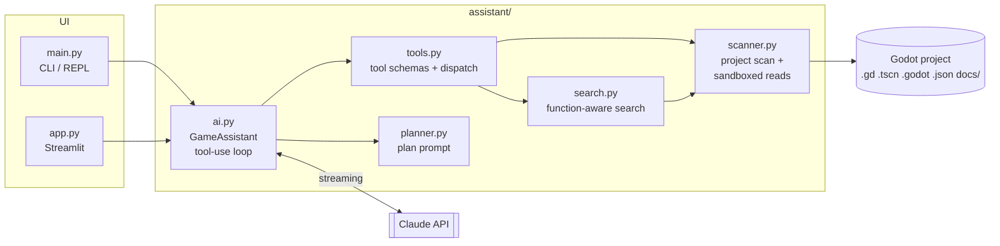

# AI Game Dev Assistant

An AI agent that understands a Godot 4 game's codebase. Ask how a mechanic works, get an implementation plan for a new feature grounded in your actual scripts, scenes and data, and find out where the code has drifted from your design docs.

Built with Python, the Anthropic API (Claude), and Streamlit. Includes a CLI and a web UI.

<!-- Add a screenshot or GIF of the web UI here, e.g.  -->

## Why

General-purpose AI chat tools don't know your project. Pasting code in by hand loses the context that matters most in Godot, which isn't in the scripts at all: node trees and Inspector values in `.tscn` scenes, signal connections made in the editor, the Input Map in `project.godot`, and balance data in JSON. This assistant loads the whole codebase and gives the model tools to look up the rest itself. Answers then point to specific files and functions instead of generic advice.

## What it does

| Mode | Example | Output |
|---|---|---|
| **Ask** | "Where is stamina modified?" | An answer that cites files and functions, e.g. `fists/FistBase.gd` → `punch()` |
| **Plan** | "Add a grab-and-throw move" | A structured plan: summary, affected files table, ordered steps with GDScript sketches, risks rated by severity, test checklist, open questions. Saved to `plans/` |
| **Chat** | Follow-up questions | Multi-turn conversation, saved to `chats/` |
| **Search** | `--search stamina` | Instant local search that labels each match with its enclosing function. No API call |

**Example:** for a grab-and-throw feature request, the assistant read `project.godot` to find that both punches are bound to mouse buttons (so detecting a two-button press needs a timing window). It found that `ThumbsUpFist.gd` overrides `punch()` and would be affected, and that enemy fists share the hitbox collision mask, so grab fists would still clash with them. See [`plans/`](plans/) for the full output.

## Architecture



**A request in practice:**

1. On load, `scanner.py` reads every `.gd` script and design doc and indexes the other text files (scenes, resources, settings, data).
2. `ai.py` sends the system prompt, the project context and the tool definitions with the conversation history.
3. If the model needs scene or config details, it emits `tool_use` blocks. The app runs them locally and returns `tool_result` blocks, repeating up to 10 rounds.
4. Text streams back as it's generated. Both front ends consume the same Python generator.

## Design decisions

- **Full context plus on-demand tools, instead of RAG.** Indie-scale GDScript codebases fit comfortably in the context window, so every script is sent in full. That avoids retrieval misses on cross-file questions like "what inherits from this base class?". Larger, noisier files (scenes, data) are fetched only when needed through `read_file` and `search_project`.
- **Prompt caching.** The project context is a cached system-prompt block and the conversation is cached too, so follow-up questions read the codebase at the cache-read rate (about 5% of the normal input price). Every answer reports its token usage and an estimated cost.
- **Model input is untrusted.** Tool arguments come from the model, so they're validated. `read_project_file` resolves paths (following `..` and symlinks) and rejects anything outside the project root, any non-text extension, and Godot's cache. Secrets like `.env` can't be read. Tool errors go back to the model as `is_error` results so it can recover instead of the request crashing.
- **Bounded, transactional agent loop.** Tool use is capped at `MAX_TOOL_ROUNDS`, and the last round sets `tool_choice: none` to force a final answer. Each turn is buffered and only committed to history once it completes, so a network error or a truncated `tool_use` never leaves the conversation in an invalid state.
- **Design docs as intent, code as truth.** Design docs in `docs/` are passed in separately, and the model is told to flag disagreements with the code. This turns the assistant into a lightweight check for drift between spec and implementation.
- **Effort per task.** Questions run at `medium` effort. Plans run at `high` effort with a larger output budget and a fixed section template, so plans come out consistent and comparable.
- **Read-only by design.** The agent proposes changes and never edits files. The developer stays in control of the game.

## Testing

```powershell
pip install -r requirements-dev.txt
pytest
ruff check . ; ruff format --check .
```

The suite runs fully offline. The agent-loop tests replace the Anthropic client with a scripted fake to check:

- tool results are sent back with the right IDs, and history is re-sent on follow-ups
- tools are disabled on the final round
- truncated tool calls and API failures mid-turn leave the history clean
- garbled streamed tool input is retried
- the cost estimate is accurate

Other tests cover the path sandbox (traversal, absolute paths, blocked extensions, cache folders), search function attribution, tool input validation, and plan/transcript persistence. GitHub Actions runs lint and tests on Python 3.12 and 3.13.

## Setup

Requires Python 3.12+ and an [Anthropic API key](https://console.anthropic.com).

```powershell
python -m venv .venv
.venv\Scripts\Activate.ps1
pip install -r requirements.txt
Copy-Item .env.example .env   # add ANTHROPIC_API_KEY and, optionally, GODOT_PROJECT_DIR
```

### Web UI

```powershell
streamlit run app.py   # http://localhost:8501 (bound to localhost only)
```

### CLI

```powershell
python main.py                                   # list what the assistant can see
python main.py --search stamina                  # local search, no API call
python main.py --ask "Where is stamina modified?"
python main.py --plan "Add a heavy punch"        # saved to plans/
python main.py --chat                            # REPL with /plan and /search
```

Options: `--docs <dir>` for design docs outside the project, and `--include-addons` to also scan third-party plugins.

## Project layout

| Path | Responsibility |
|---|---|
| `assistant/ai.py` | `GameAssistant`: request building, streaming, tool-use loop, cost tracking |
| `assistant/tools.py` | Tool schemas and validated dispatch |
| `assistant/scanner.py` | Project discovery and sandboxed file reads |
| `assistant/search.py` | Case-insensitive search with GDScript function attribution |
| `assistant/planner.py` | Implementation-plan prompt template and persistence |
| `assistant/transcript.py` | Markdown chat transcripts |
| `main.py` / `app.py` | CLI and Streamlit front ends |
| `tests/` | Offline pytest suite |

## Limitations and next steps

- **Project size:** very large codebases would exceed the context window. The next step would be a per-file summary index with retrieval for scripts.
- **GDScript only:** C# Godot projects aren't parsed for function attribution.
- **Evaluation:** a benchmark of questions with known answers, such as "which function modifies X?", would allow measuring answer accuracy across prompt and model changes.
